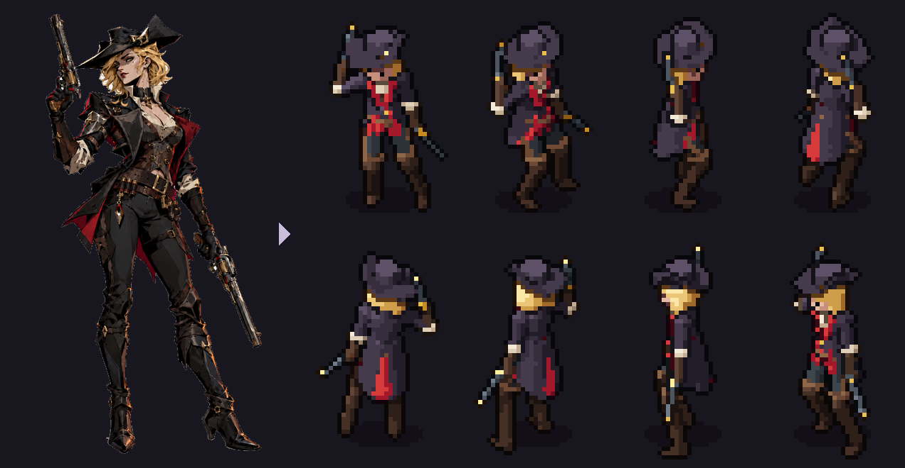
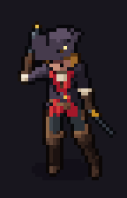
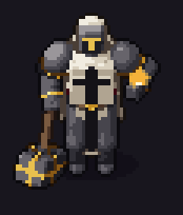

<p align="center">
  
</p>

# SpriteKiln

[English](README.md) | [Português (BR)](README.pt-BR.md) | [한국어](README.ko.md) | **日本語** | [简体中文](README.zh-CN.md)

**プロシージャル3Dモデルから、アニメーション付きのピクセルアートスプライトを。コーディングAIが操作することを
前提に設計されています。**

キャラクターは小さなYAMLファイル1つです。骨格、なめらかな3D形状、マテリアル、アニメーションを記述します。
SpriteKilnはそれを8方向（トップダウン3/4）または横向き（サイドビュー）のピクセルアートにレンダリングします。
フレームごとの正確な表示時間、ゲームプレイ用イベント、アタッチポイント（ソケット）、動的ライティング用の
ノーマルマップ、発光レイヤーを備え、Godot、Unity、MonoGame、またはAsepriteのスプライトシートを読めるあらゆる
エンジンですぐに使えます。

YAMLを自分で書く必要はありません。コーディングアシスタント（Claude Code、Codex、Gemini、Copilot、Cursor）が
説明やスプラッシュアートからスペックを書き、レンダリングし、**画像を見て**、気づいた点を直します。あなたは方向性を
示すだけです。

<p align="center">
  
  
  
</p>

## 特長
- **構造的に一貫している。** すべてのアセットが、すべての方向とフレームで同じカメラ、ライト、パレットを共有します。
- **変更が安い。** 「帽子を大きく」「攻撃の溜めを遅く」は300フレームの描き直しではなく、1行の修正です。
- **そのままゲームに使える。** フレームごとの表示時間、正しいフレームに付いたイベント（`hit`、`step_l`、
  `windup`）、ソケット（銃口、手、命中点）、Yソート用の接地ピボット、ノーマルマップと発光マップ。
- **AIのための設計。** どのアシスタントにも使える1組の指示、画像を返すMCPサーバー、スペックのJSON Schema、
  `ファイル:行:列` 形式のエラー、画像を見られないアシスタント向けの数値によるアートディレクションレビュー。
- **純粋なPython、どのOSでも。** numpy、Pillow、PyYAMLのみ。GPUもBlenderも不要です。Windows、macOS、Linuxで
  テスト済みです。

## インストール

Python 3.10以上が必要です。`spritekiln` コマンドは [pipx](https://pipx.pypa.io) でインストールします。他の
パッケージから隔離され、PATHに追加されます。

**Windows**（PowerShell。Pythonがなければ `winget install Python.Python.3.13` を実行し、新しいターミナルを開く）

```powershell
py -m pip install --user pipx
py -m pipx ensurepath
py -m pipx install "spritekiln[mcp]"
```

**macOS**（ターミナル、[Homebrew](https://brew.sh) を使用）

```bash
brew install pipx
pipx ensurepath
pipx install "spritekiln[mcp]"
```

**Linux**（Debian/Ubuntuの例。Fedoraは `sudo dnf install pipx`、Archは `sudo pacman -S python-pipx`）

```bash
sudo apt install pipx
pipx ensurepath
pipx install "spritekiln[mcp]"
```

その後、新しいターミナルを開いて `spritekiln --version` で確認してください。`[mcp]` はAIアシスタント向けの
ツールを追加します。コマンドラインだけなら `pipx install spritekiln` で十分です。uv、仮想環境、アップグレード、
トラブルシューティングは [Install SpriteKiln](docs/tutorials/install.md)（英語）を参照してください。

## クイックスタート

コマンドはどのOSでも同じです。

### 1. フォルダの準備（最初に一度だけ）

ゲームのフォルダ（スプライトだけが欲しい場合は空のフォルダ）でターミナルを開き、スプライトを使うエンジンと、
スプライトを作るAIアシスタントをSpriteKilnに伝えます：

```
spritekiln init --engine godot --ai claude
```

| `--engine` | 対象 | エクスポート先 |
|---|---|---|
| `godot` | Godot 4 | `assets/spritekiln/`（SpriteFramesとすぐ使えるシーン付き） |
| `unity` | Unity 2022.3+ | `Assets/SpriteKiln/` |
| `monogame` | MonoGame | `Content/sprites/` |
| `generic` | その他のエンジン、またはゲームがまだない場合 | `sprites/`：PNGアトラスとAseprite互換JSON |

| `--ai` | アシスタント |
|---|---|
| `claude` | Claude Code |
| `codex` | Codex |
| `gemini` | Gemini CLI |
| `copilot` | GitHub Copilot |
| `cursor` | Cursor |
| `generic` | `AGENTS.md` を読むその他のエージェント |

複数のアシスタントはカンマで区切ります：`--ai claude,cursor`。`init` は `spritekiln.toml`（スペックは
`art/specs/`、エクスポートは上のフォルダ）、アシスタントが作業前に読む指示、そしてアシスタントがSpriteKilnを
呼び出すMCPサーバーの設定を書き出します。詳しくは [Use SpriteKiln with your AI](docs/tutorials/use-with-your-ai.md)
（英語）を参照してください。

### 2. アシスタントにスプライトを頼む

アシスタントでフォルダを開き、キャラクターを説明します：

> 短剣を持ったフード姿のゴブリン斥候を作って。テンプレートから始めて、8方向すべてを確認してから、idle、walk、
> attackをレンダリングしてエクスポートして。

アシスタントがスペックを書き、レンダリングし、画像を見て直します。あなたは
`art/specs/characters/<名前>/out/<名前>/preview/` のGIFを確認して、変更を頼むだけです（「帽子を大きく」
「振りを速く」）。スプラッシュアートがあれば渡しましょう：[スプラッシュアートから](docs/tutorials/splash-art.md)（英語）。

### 3. 手作業で行う場合

アシスタントが実行するのと同じコマンドです：

```
spritekiln new knight                                                # art/specs/characters/knight/knight.yaml
spritekiln pose art/specs/characters/knight/knight.yaml --dirs all   # 1つのポーズを8方向で、各方向およそ1秒
spritekiln render art/specs/characters/knight/knight.yaml --export   # 全アニメーションを描画し、エンジンへエクスポート
```

`pose` の合間にYAMLを編集します。[最初のキャラクター](docs/tutorials/first-character.md)（英語）で手順を
たどれます。

## しくみ

```
spec.yaml ──► 骨格 + IK ──► SDF形状 ──► レイマーチング描画 ──► ピクセル化 ──► アトラス + JSON
```

ライトはワールドに固定され、モデルが回転するため、すべての方向で陰影が一貫します。レンダリングのたびにQAレポートと
確認用のコンタクトシートが出力されます。

## エンジン

| エンジン | 提供されるもの | ガイド |
|---|---|---|
| **Godot 4** | `KilnSprite2D` ノード、SpriteFrames、完成したシーン。レンダーJSONからそれらを作るエディタープラグイン | [godot.md](docs/engines/godot.md) · [サンプル](examples/godot) |
| **Unity 2022.3+** | UPMパッケージ：`.kiln` インポーター（スプライト、ノーマルマップ、AnimationClip）と `KilnAnimator` | [unity.md](docs/engines/unity.md) |
| **MonoGame** | `KilnSprite.cs` ランタイムとノーマルマップ対応ライトシェーダー `KilnLit.fx` | [monogame.md](docs/engines/monogame.md) · [サンプル](examples/monogame) |
| **その他** | Aseprite互換JSON：Phaser、LÖVE、Defold、GameMaker… | [generic.md](docs/engines/generic.md) |

## AIアシスタント
`spritekiln init --ai claude,codex,gemini,copilot,cursor` は、ひとつの原本（[`docs/agent/`](docs/agent)）から各
アシスタント用の指示を生成し、MCPサーバー（`spritekiln mcp`）を登録します。スプラッシュアートから新しい
キャラクターを作るレシピ：モデラーが形を作り、アートディレクターが原画と比べ、モデラーが修正し、アニメーターが
アニメーションを付け、ディレクターがもう一度レビューします（[recipe.md](docs/agent/recipe.md)）。

## ショーケース
テンプラーとハントレスは、ゲーム **Hunt Tower** のために、スプラッシュアートをもとに上のレシピに従ったClaude Codeが
SpriteKilnで作りました。画像、アニメーション、ゲーム画面は [`showcase/`](showcase) にあります。

## さらに詳しく
ドキュメントはすべて英語です：[README](README.md)、[インストール](docs/tutorials/install.md)、
[最初のキャラクター](docs/tutorials/first-character.md)、
[スプラッシュアートから](docs/tutorials/splash-art.md)、[アニメーションとイベント](docs/tutorials/animations.md)、
[プラットフォーマーキャラクター](docs/tutorials/platformer.md)、[スペックリファレンス](docs/agent/spec.md)、
[出力フォーマット](docs/format.md)、[ロードマップ](docs/ROADMAP.md)、[コントリビュート](CONTRIBUTING.md)。

## ライセンス
コード、ドキュメント、各エンジン連携：[MIT](LICENSE)。サンプルアセット（ガーゴイル、ハンター、レン、小道具（木箱、
ガス灯、訓練用人形）、テンプレート、gothic・propsパレット、サンプルのスプライト）：[CC0 1.0](LICENSES/CC0-1.0.txt)。
ショーケースのアセット（Hunt Towerのテンプラーとハントレス、ハントレスの地雷：スペック、スプラッシュアート、パレット、
レンダー、ゲーム画面）：© 2026 Lucas Ramos / PlayRPG、無断転載禁止、デモ目的でのみ収録
（[条件](LICENSES/LicenseRef-Showcase.txt)）。
