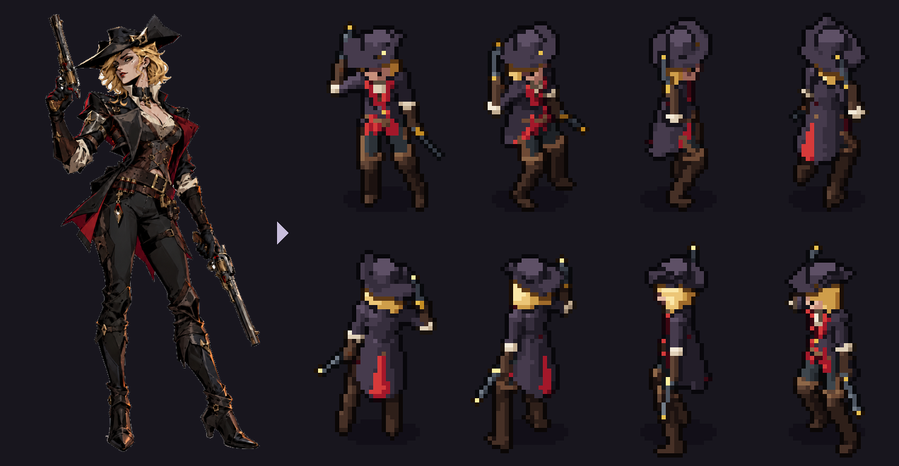
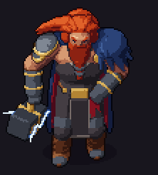
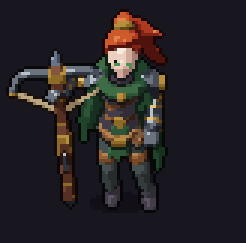
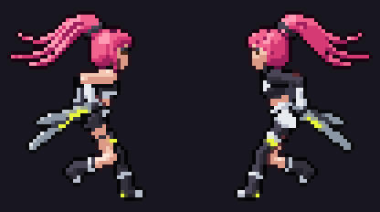
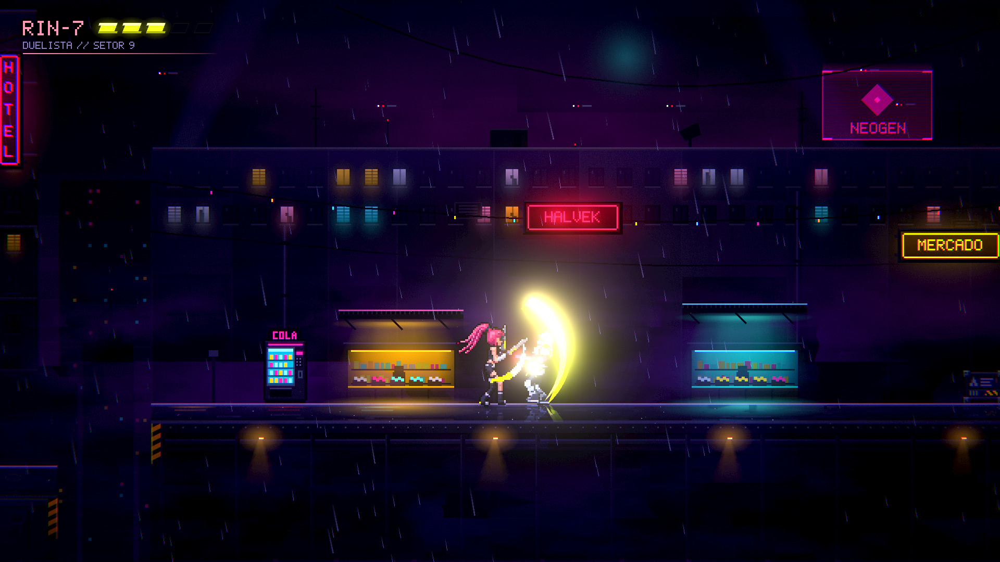
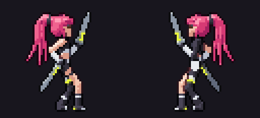
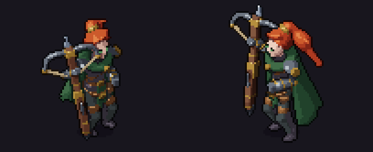
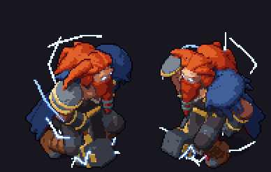

<p align="center">
  
</p>

# SpriteKiln

[English](README.md) | [Português (BR)](README.pt-BR.md) | [한국어](README.ko.md) | [日本語](README.ja.md) | **简体中文**

**用程序化3D模型生成动画像素风精灵，专为编程AI驱动而设计。**

一个角色就是一个小小的YAML文件：骨骼、3D形状、材质和动画。SpriteKiln将其渲染为8方向（俯视3/4视角）或侧视
（横版）的像素画，带有逐帧精确时长、游戏事件、挂点（socket）、用于动态光照的法线贴图和自发光层，可直接用于
Godot、Unity、MonoGame，或任何能读取Aseprite精灵表的引擎。

你不需要亲手写YAML，你的编程助手（Claude Code、Codex、Gemini、Copilot、Cursor）会根据描述或原画来写：它编辑
规格文件、渲染、**查看图像**，并修正它看到的问题。你只需把握方向。

<p align="center">
  
  
  
  <br>
  <sub>Thor（俯视，高100 px）· 游侠（俯视，64 px）· RIN-7（侧视，48 px）：均由Claude Code用SpriteKiln根据原画制作。<a href="#作品展示">下方还有更多</a>。</sub>
</p>

## 为什么选择它
- **天生一致。** 所有资源在每个方向、每一帧都共用同一个相机、同一种光照和同一套调色板。东北方向的行走和
  西南方向的攻击之间不会走样。
- **修改成本低。** “把帽子加大”或“把攻击蓄力放慢”只是改一行，而不是重画300帧。
- **直接用于游戏。** 逐帧时长、落在正确帧上的事件（`hit`、`step_l`、`windup`）、挂点（枪口、手、命中点）、
  用于Y排序的地面锚点、法线贴图和自发光贴图。
- **为AI设计。** 一套适用于所有助手的说明、返回图像的MCP服务器、规格文件的JSON Schema、`file:line:column`
  格式的错误信息，以及为看不到图像的助手提供的数值化美术评审。
- **纯Python，任何系统。** 只依赖numpy、Pillow和PyYAML，无需GPU，无需Blender。已在Windows、macOS和Linux上测试。

## 安装

需要Python 3.10或更高版本。使用 [pipx](https://pipx.pypa.io) 安装 `spritekiln` 命令，它与其他软件包隔离，
并会加入PATH：

**Windows**（PowerShell。还没有Python？先运行 `winget install Python.Python.3.13`，再打开新的终端）

```powershell
py -m pip install --user pipx
py -m pipx ensurepath
py -m pipx install "spritekiln[mcp]"
```

**macOS**（终端，使用 [Homebrew](https://brew.sh)）

```bash
brew install pipx
pipx ensurepath
pipx install "spritekiln[mcp]"
```

**Linux**（以Debian/Ubuntu为例；Fedora用 `sudo dnf install pipx`，Arch用 `sudo pacman -S python-pipx`）

```bash
sudo apt install pipx
pipx ensurepath
pipx install "spritekiln[mcp]"
```

然后打开新的终端，用 `spritekiln --version` 检查。`[mcp]` 为AI助手添加工具；只用命令行的话，
`pipx install spritekiln` 就够了。若改为安装 `"spritekiln[mcp,fast]"`，渲染速度可提升约6倍（使用编译型渲染器；
Intel Mac仍使用普通渲染器）。uv、虚拟环境、升级和常见问题，请参阅 [安装SpriteKiln](docs/tutorials/install.md)（英文）。

### 升级

| 当前版本 | 运行 |
|---|---|
| 0.2或更高版本 | 在一个游戏文件夹中运行 `spritekiln update`（它按你当初的安装方式升级，并刷新该文件夹中供AI读取的说明），然后在其他游戏文件夹中运行 `spritekiln update --files` |
| 0.1.0 | `pipx upgrade spritekiln`（或 `uv tool upgrade spritekiln`），然后在每个游戏文件夹中运行 `spritekiln update --files` |
| 任意版本，想加装快速渲染器 | `pipx install --force "spritekiln[mcp,fast]"`（或 `uv tool install --force "spritekiln[mcp,fast]"`） |

在Windows的虚拟环境中，请运行 `python -m spritekiln update`。用新版本重新渲染的资源，外观可能会有变化（0.3
改变了明暗处理）：具体改动见 [更新日志](CHANGELOG.md)。

## 快速开始

所有系统上的命令都一样。

### 1. 配置文件夹（只需一次）

在游戏文件夹中（如果只想要精灵图，在一个空文件夹中）打开终端，告诉SpriteKiln精灵图用于哪个引擎、由哪个AI助手来制作：

```
spritekiln init --engine godot --ai claude
```

| `--engine` | 用于 | 导出位置 |
|---|---|---|
| `godot` | Godot 4 | `assets/spritekiln/`，附带SpriteFrames和可直接使用的场景 |
| `unity` | Unity 2022.3+ | `Assets/SpriteKiln/` |
| `monogame` | MonoGame | `Content/sprites/` |
| `generic` | 其他引擎，或还没有游戏 | `sprites/`：PNG图集和兼容Aseprite的JSON |

| `--ai` | 助手 |
|---|---|
| `claude` | Claude Code |
| `codex` | Codex |
| `gemini` | Gemini CLI |
| `copilot` | GitHub Copilot |
| `cursor` | Cursor |
| `generic` | 其他会读取 `AGENTS.md` 的智能体 |

多个助手用逗号分隔：`--ai claude,cursor`。`init` 会写入 `spritekiln.toml`（规格文件放在 `art/specs/`，导出到
上表中的文件夹）、助手开始工作前读取的说明，以及助手调用SpriteKiln所用的MCP服务器配置。详情请参阅
[配合你的AI使用SpriteKiln](docs/tutorials/use-with-your-ai.md)（英文）。

### 2. 让助手制作精灵图

在助手中打开该文件夹，描述角色：

> 做一个戴兜帽、拿短剑的哥布林斥候。从模板开始，检查全部8个方向，然后渲染idle、walk和attack并导出。

第一次使用时，助手在制作任何东西之前会先就美术风格向你提问：俯视还是侧视、角色在屏幕上有多少像素高、方向数、
颜色、描边和明暗、比例、面部刻画到什么程度、动画的感觉以及参考。回答会记录在 `spritekiln.toml` 中
（用 `spritekiln style` 查看）；之后的每个精灵图都遵循它，只有在你要求时才会改变（“从现在起不要描边”）。

然后助手会编写规格文件、渲染、查看图像，并修正它看到的问题。你只需查看
`art/specs/characters/<name>/out/<name>/preview/` 中的GIF并提出修改（“帽子再大一点”、“挥砍再快一点”）。
有原画？交给它：[借助AI，从你的原画开始](docs/tutorials/splash-art.md)（英文）。

### 3. 或者手动操作

与助手运行的命令相同：

```
spritekiln style set --height 48 --outline selective                 # 美术风格，只需一次（全部选项：-h）
spritekiln new knight                                                # art/specs/characters/knight/knight.yaml
spritekiln pose art/specs/characters/knight/knight.yaml --dirs all   # 一个姿势的8个方向，每个方向约1秒
spritekiln render art/specs/characters/knight/knight.yaml --export   # 渲染全部动画并导出到引擎
```

在两次 `pose` 之间编辑YAML：[10分钟完成你的第一个角色](docs/tutorials/first-character.md)（英文）
会带你一步步完成。

## 作品展示

<p align="center">
  
  <br>
  <sub>Godot测试场景中的RIN-7和保安：SpriteKiln精灵通过法线贴图被霓虹灯照亮。城市、雨和斩击的光效都来自场景本身。</sub>
</p>

| RIN-7 · 侧视，48 px | 游侠 · 俯视，64 px | Thor · 俯视，100 px |
|---|---|---|
|  |  |  |
| 7段动画（idle、run、jump、rise、fall、land、attack），84帧 | 8个方向的4段动画（idle、run、dash、attack），288帧 | 8个方向的13段动画，696帧，帧尺寸128 px |
| [原画 → 精灵](showcase/rin-7/from_this_to_this.png) | [原画 → 精灵](showcase/ranger/from_this_to_this.png) | [原画 → 精灵](showcase/thor/from_this_to_this.png) |

均由Claude Code按照[流程](docs/agent/recipe.md)（建模师、美术总监、动画师）制作。RIN-7和游侠来自0.3的测试项目，
Thor来自0.1的一个测试项目；Templar和Huntress是为游戏 **Hunt Tower** 制作的。全部角色及更多动画见
[`showcase/`](showcase)。

## 更新内容

**0.3**（2026-10-30）
- **形体更锐利：** 挤出和旋转轮廓、管体、壳体与切割，让刀刃、甲片、帽檐和披风拥有清晰的边缘，而不再是
  鼓胀的圆团。
- **材质一目了然：** 表面处理（metal、soft、matte、glossy）带有高光、褶皱和边缘光，还可用表面涂装画出条带、
  铆钉和纹章。
- **应用你的风格：** 渲染器把项目的描边、明暗（soft、flat、toon）、内线、抖动和光照应用到每个资源上；
  `spritekiln style preview` 会并排展示各种选择。
- **基础模型和套件：** `extends: humanoid` 和20个内置套件（武器、盾牌、头饰、披风、腰带、头部和发型），
  角色只需声明自己独有的部分。
- **首个角色更出色：** 头部和发型套件、风格问答中新增的面部问题，以及 `pose --focus head` 特写。
- **更快：** 更紧凑的边界让每帧快1.5–3倍，`[fast]` 再快约6倍，还有 `--draft` 草稿预览。

**0.2**（2026-10-25）
- 在制作第一个资源之前，助手会就美术风格向你提问，并记录在 `spritekiln.toml` 中；之后的每个资源都遵循它。
- `spritekiln update` 会升级SpriteKiln，并刷新你各个游戏文件夹中的AI说明。

其余改动见 [更新日志](CHANGELOG.md)。

## 工作原理

```
spec.yaml ──► 骨骼 + IK ───► SDF形状 ────► 光线步进渲染 ──► 像素化 ──────► 图集 + JSON
 (骨骼、      (逐帧表达式：  (椭球、       (颜色、法线、    (调色板色阶、  + 法线贴图
  形状、       循环、         挤出体、      深度、涂装；     描边、线条、  + 自发光贴图
  套件、       关键帧、       旋转体、      3倍超采样，      项目的风格)   + GIF、QA
  动画)        事件)          管体、切割)   固定世界光照)                  -> 你的引擎
```

光源固定在世界空间中，由模型旋转，因此各个方向的明暗保持一致。每次渲染都会生成QA报告（越界裁切、调色板、
剪影稳定性）和用于检查的预览表。

## 功能
- **美术风格：** 在制作第一个资源之前，助手会询问视角、屏幕上的尺寸、方向、颜色、描边、明暗、比例、面部和
  动画；项目保存这些回答，渲染器把相应的外观（描边、soft/flat/toon明暗、内线、高光、抖动、光照）应用到每个
  资源上。`spritekiln style preview` 会并排展示各种选择。
- **建模：** 带表达式的骨骼（`"0.045*sin(p)"`）、双骨骼IK、镜像的 `_L`/`_R` 部件，以及形体清晰的形状：挤出和
  旋转轮廓、管体、壳体、平面切割、倒角和阶梯式融合。材质支持调色板色阶和表面处理（metal、soft、matte、
  glossy）、褶皱和边缘高光、表面涂装（条带、铆钉、十字，无需新增几何体）、自发光和辉光，以及双面膜片。
- **基础模型和套件：** `extends: humanoid` 和20个带参数的内置套件（武器、盾牌、头饰、披风、腰带、头部和发型），
  角色只需声明自己独有的部分：骑士示例只有约20行。
- **动画：** 由表达式或关键帧生成循环，支持逐帧时长、补间和缓动、拖影帧、逐方向微调、事件，以及由 `validate`
  检查的时间目标（例如“300 ms时命中”）。
- **视角：** 俯视3/4视角，8个（或4个、1个）方向；或用于平台游戏的侧视（`view: side`，附带包含run、jump、rise、
  fall和land的模板）；对于左右对称的设计，`mirror: true` 只渲染朝右的方向（其余由引擎翻转）。
- **从原画开始：** `ref prep` 抠出角色并提取调色板；`ref compare` 为剪影与模型的吻合度打分（经俯仰校正的IoU），
  并指出需要修改的地方。
- **评审：** `spritekiln review` 测量明度范围、对比度、每种材质的像素数和可辨识度，并在你游戏的地面（`--bg`）上、
  在它的光照（`--tint`）下预览精灵；`pose --focus head` 可近距离查看面部。
- **速度：** 编译型渲染器（`[fast]`，快约6倍）、草稿预览，以及无需重新追踪就能为一帧重新打光的渲染缓存。
- **输出：** 图集、法线和自发光贴图、兼容Aseprite的JSON（[格式](docs/format.md)）、逐帧挂点、GIF和预览表。

## 引擎

| 引擎 | 提供的内容 | 指南 |
|---|---|---|
| **Godot 4** | `KilnSprite2D` 节点、SpriteFrames 和现成场景；编辑器插件可根据拖入的JSON生成它们 | [godot.md](docs/engines/godot.md) · [示例](examples/godot) |
| **Unity 2022.3+** | UPM包：`.kiln` 导入器（精灵、法线贴图、AnimationClip）和 `KilnAnimator` | [unity.md](docs/engines/unity.md) |
| **MonoGame** | `KilnSprite.cs` 运行时和法线贴图光照着色器 `KilnLit.fx` | [monogame.md](docs/engines/monogame.md) · [示例](examples/monogame) |
| **其他引擎** | 兼容Aseprite的JSON：Phaser、LÖVE、Defold、GameMaker…… | [generic.md](docs/engines/generic.md) |

所有运行时的播放方式都相同：精确时长、事件落在所属的帧上、挂点、选取与速度最接近的方向、镜像方向。

## AI助手

| 助手 | `--ai` | 说明 | MCP工具 |
|---|---|---|---|
| Claude Code | `claude` | `CLAUDE.md`、技能（skills），以及建模师/动画师/美术总监智能体 | `.mcp.json` |
| Codex | `codex` | `AGENTS.md` | `~/.codex/config.toml`（需手动添加） |
| Gemini CLI | `gemini` | `GEMINI.md` | `.gemini/settings.json` |
| GitHub Copilot | `copilot` | `.github/copilot-instructions.md` | `.vscode/mcp.json` |
| Cursor | `cursor` | `.cursor/rules/spritekiln.mdc` | `.cursor/mcp.json` |
| 其他智能体 | `generic` | `AGENTS.md` | |

`spritekiln init --ai claude,codex,...` 从同一份源文件（[`docs/agent/`](docs/agent)）生成这些文件。根据原画
制作新角色的流程：建模师搭建形体，美术总监对照原画评审，建模师修改，动画师制作动画，美术总监再次评审
（[recipe.md](docs/agent/recipe.md)）。

## 了解更多
- [安装SpriteKiln](docs/tutorials/install.md)（Windows、macOS、Linux；pipx、uv或虚拟环境）
- [10分钟完成你的第一个角色](docs/tutorials/first-character.md)
- [借助AI，从你的原画开始](docs/tutorials/splash-art.md)
- [动画与事件](docs/tutorials/animations.md)
- [平台游戏角色（侧视）](docs/tutorials/platformer.md)
- [配合你的AI使用SpriteKiln](docs/tutorials/use-with-your-ai.md)（说明文件和MCP工具）
- [规格参考](docs/agent/spec.md) · [输出格式](docs/format.md) · [路线图](docs/ROADMAP.md)
- [作品展示](showcase) · [参与贡献](CONTRIBUTING.md) · [更新日志](CHANGELOG.md) · 译本：[English](README.md)、[Português (BR)](README.pt-BR.md)、[한국어](README.ko.md)、
  [日本語](README.ja.md)

## 许可
代码、文档和引擎集成：[MIT](LICENSE)。示例资源（石像鬼、猎人、骑士、Wren、木箱、煤气灯和训练假人道具、模板和
套件、gothic和props调色板、示例中的精灵）：[CC0 1.0](LICENSES/CC0-1.0.txt)。展示资源（Hunt Tower的Templar和
Huntress，以及Huntress的地雷：规格文件、原画、调色板、渲染图和游戏截图；RIN-7、游侠和Thor：原画、渲染图和
截图）：© 2026 Lucas Ramos（Hunt Tower：Lucas Ramos / PlayRPG），保留所有权利，仅用于演示
（[条款](LICENSES/LicenseRef-Showcase.txt)）。[`REUSE.toml`](REUSE.toml) 为每个路径标明其许可。
