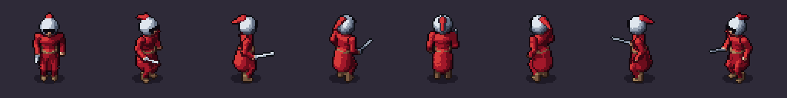
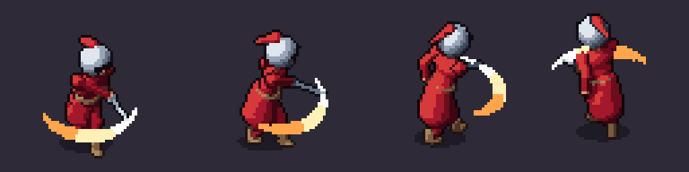

# Animations and events

This continues [Your first character](first-character.md): the knight's attack will land when the game
expects it, and the game will know where the blade hits. Along the way you will see how SpriteKiln
animations are written.



## Two ways to animate

Animations move **channels**: named numbers (or vectors) that the skeleton reads, such as `bob`, `twist`,
`lean` or `hand_R`. Open `knight.yaml` and look at `animations:`.

**Cycles** loop and are written as expressions of the phase `p`, which runs from 0 to 2π over the cycle:

```yaml
  walk:
    frames: 8
    ms: 100
    events: {0: step_l, 4: step_r}
    channels:
      bob: "-0.035*cos(2*p) + 0.01"          # lowest when a foot touches the ground, twice per cycle
      foot_L: "[0.13, 0.10*pos(-sin(p)), 0.02 + 0.24*cos(p)]"
```

Anything periodic in `p` loops seamlessly. Use them for idle, walk, run, hover.

**Keys** are poses, one per frame, each with its own duration. Use them for actions: attack, hurt, death,
jump. Channels a key does not set return to their defaults.

```yaml
  attack:
    loop: false
    keys:
      - {ms: 80, set: {hand_R: [0.30, 0.10, 0.16]}}       # ready
      - ms: 110                                           # anticipation: twist away, blade back
        set: {twist: -0.45, hand_R: [0.42, 0.62, -0.12], ...}
      - ms: 160
        event: windup                                     # the held extreme of the anticipation
        set: {twist: -0.60, hand_R: [0.40, 0.74, -0.22], ...}
      - ms: 50                                            # the strike: one short frame with a smear
        set: {twist: 0.30, smear_w: 0.09, ...}
      - ms: 80
        event: hit                                        # the impact
        set: {twist: 0.60, ...}
```

Pixel-art timing lives in these `ms` values: a long held anticipation, a very short strike, a slower
recovery. See [animation.md](../agent/animation.md) for frame counts and timings that work at 64 px.

## Events

`event:` (or `events:` in a cycle) marks a frame. The event goes into the JSON, and the engine runtimes
emit it when that frame becomes visible: `anim_event` in Godot, `EventFired` in Unity, `OnEvent` in
MonoGame. Your game reacts to `hit`, not to "frame 4 of attack_ne".

An event on frame *i* fires at the sum of the durations before it. Here: 80 + 110 + 160 + 50 = **400 ms**.

## Timing targets

Say your game design wants the hit at 350 ms. Write it in the spec:

```yaml
timing: {attack: {hit: 350ms}}   # the game deals damage 350 ms after the attack starts
```

`validate` now fails, with the position of the line:

```
INVALID:
  - specs\characters\knight\knight.yaml:170:19: timing.attack.hit: at 24.0 f (400 ms) but the target is 21 f (+-1 f at 60 fps)
```

Shorten the held anticipation from 160 to 110 ms and `validate` is OK again. Targets accept `ms` or frames
at 60 fps (`2f`), and a clip's `total`; a frame of tolerance is allowed. QA checks them on every render
too, so a later edit cannot silently break the game's timing.

## Sockets

Where should the game spawn the spark and the hitbox? Not at the sprite's corner: at the point where the
blade lands, which moves with every frame and direction. Declare a socket:

```yaml
sockets:
  strike: {bone: root, offset: [0, 0.8, 0.7]}   # where the blade lands: spawn sparks and hitboxes here
```

`bone` is any bone (a hand, a weapon, `root`); `offset` is in its coordinates. The JSON gets the socket's
position for every frame and direction, in pixels from the pivot plus a depth (in front of or behind the
body), and the runtimes answer `get_socket("strike")` / `TryGetSocket("strike", ...)` for the current
frame. Sockets ending in `_L` get an automatic `_R` twin.



## Check before you render

```
spritekiln pose specs/characters/knight/knight.yaml --anim attack --frame 4 --dirs s,se,e,n
spritekiln render specs/characters/knight/knight.yaml --anims attack
```

`pose` shows one frame in a second; `render --anims` re-renders only that animation (unchanged frames come
from the cache). Then open `preview/contact_attack.png`: one row per direction, one column per frame.
Check `n` and the diagonals: an attack that reads in `s` can vanish behind the body in `n`.

QA flags what usually goes wrong: a gesture clipped at the frame's edge, a loop that jumps between its last
and first frame, identical frames, a missed timing target.

## Next
- More channels, smears, per-direction cheats and the reference timings: [animation.md](../agent/animation.md).
- Platformer moves (jump, fall, land): [A platformer character](platformer.md).
- Every key: [Spec reference](../agent/spec.md).
