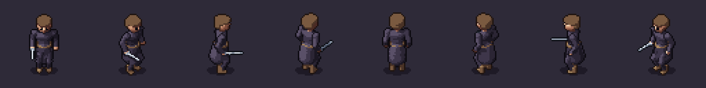
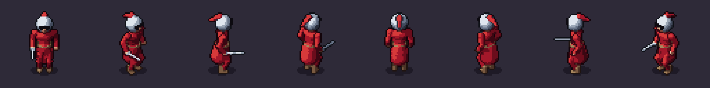
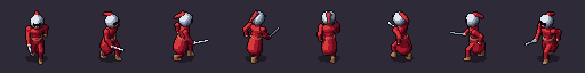

# Your first character in 10 minutes

You will turn the template character into a knight by editing its YAML by hand, then render it in 8
directions. Doing it once by hand shows what your AI assistant does for you later, and how to check its work.

## 1. Install and create

[Install SpriteKiln](install.md) (Windows, macOS or Linux), then, in a new terminal (the commands are the
same on every system):

```
mkdir my-sprites
cd my-sprites
spritekiln new knight
spritekiln pose specs/characters/knight/knight.yaml --dirs all
```

`new` copies the humanoid template to `specs/characters/knight/knight.yaml`. `pose` renders one pose in
all 8 directions (about a second each) to `specs/characters/knight/out/pose_rest_0.png`:



## 2. Read the spec

Open `knight.yaml`. The sections that matter now:

- `materials:` name the colours. Each material takes a **ramp** (a row of shades, darkest first) from the
  palette; `palette: gothic` is built in.
- `bones:` the skeleton. `head` is a bone; so are `wrist_R` (the sword hand) and `fxspace` (for effects).
- `parts:` the shapes. Each part has a material, the bone it follows (`space:`) and primitives (`sphere`,
  `ellipsoid`, `box`, `cone`, `cylinder`, `arc`...) in that bone's coordinates: x to the character's left,
  y up, z forward, in metres (the character is about 1.7 tall).
- `animations:` idle, walk and attack, written with expressions and keys.

## 3. Make it a knight

**A red tabard.** Point the `cloth` material at the palette's `blood` ramp:

```yaml
materials:
  cloth: {ramp: blood}
```

**A helmet instead of the hair.** Delete the `hair:` part and add these three parts after `head:`:

```yaml
  helmet:
    material: steel
    space: head
    blend: 0.03
    prims:
      - ellipsoid: {c: [0, 0.15, -0.01], r: [0.18, 0.19, 0.18]}
      - cone: {a: [0, 0.30, -0.02], b: [0, 0.36, -0.12], r: [0.05, 0.03]}   # crest
  plume:
    material: cloth
    space: head
    prims:
      - cone: {a: [0, 0.34, -0.10], b: [0, 0.22, -0.32], r: [0.06, 0.02]}
  visor:
    material: ink
    space: head
    prims:
      - box: {c: [0, 0.13, 0.17], half: [0.11, 0.014, 0.03]}   # eye slit
```

Check it, and look:

```
spritekiln validate specs/characters/knight/knight.yaml
spritekiln pose specs/characters/knight/knight.yaml --dirs all
```

`validate` answers `OK: knight - 21 parts, ...` or points at the problem with `file:line:column`.

## 4. Fix what the picture shows

The helmet and the plume are there, but the eye slit is not. Two lessons in one:

- **Thin things vanish.** At this camera one pixel is 0.04 m (`camera.scale`), and the head is scaled 1.25.
  A slit 0.028 m tall is less than a pixel. Make it `half: [0.12, 0.028, 0.03]`.
- **Seen from above, the face is lower than you think.** The camera looks down at 38°, so the top of the
  helmet takes most of its pixels. At `y: 0.13` the slit lands on the chin; move it up to `c: [0, 0.19, 0.16]`.

```yaml
      - box: {c: [0, 0.19, 0.16], half: [0.12, 0.028, 0.03]}   # eye slit
```



This loop — edit, `validate`, `pose`, **look** — is the whole job. Change one thing at a time, and check
the diagonals and the back too: a shape that reads well from the front can disappear from `ne`.

## 5. Render

```
spritekiln render specs/characters/knight/knight.yaml
```

This renders idle, walk and attack in 8 directions (176 frames, a few minutes; later renders reuse a
cache) into `specs/characters/knight/out/knight/`:

| File | What it is |
|---|---|
| `knight.png`, `knight.json` | the atlas and its Aseprite-compatible JSON (durations, events, pivot) |
| `knight_normal.png`, `knight_emissive.png` | the normal map (dynamic light) and the emissive layer |
| `preview/walk_8dir.gif` | each animation playing in all 8 directions |
| `preview/contact_walk.png` | every frame of an animation, for review |
| `qa.json` | automatic checks: clipping at the edges, palette, silhouette stability |



## Next

- Put it in your game: [Godot](../engines/godot.md), [Unity](../engines/unity.md),
  [MonoGame](../engines/monogame.md) or [any engine](../engines/generic.md).
- Change how it moves: [Animations and events](animations.md).
- Let your AI do the editing: [Use SpriteKiln with your AI](use-with-your-ai.md).
- Every key of the format: [Spec reference](../agent/spec.md).
