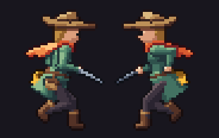
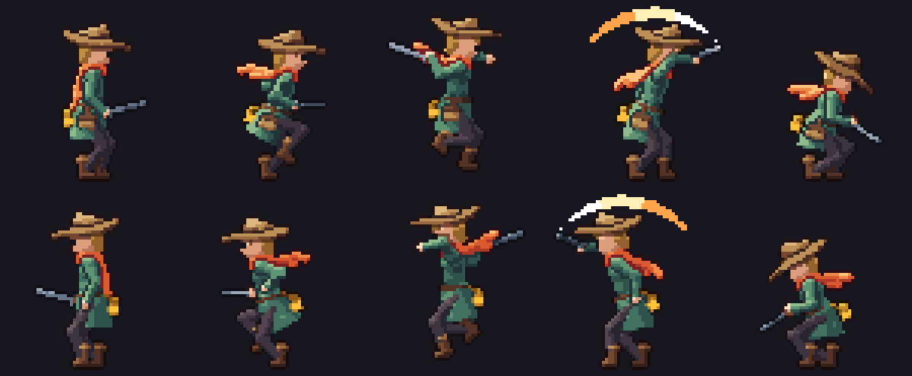

# A platformer character

Side-scrollers use the same models and workflow as top-down games; only the camera changes. This tutorial
follows Wren, the example character in [`specs/characters/wren`](../../specs/characters/wren) (public
domain), from the side template to a running, jumping sprite in Godot.



## 1. A side-view project

```
pip install spritekiln
spritekiln init --engine godot --view side --ai claude
spritekiln new wren
```

`--view side` makes every new spec a profile: camera pitch 0, directions `e` and `w`, no ground shadow.
`new` then starts from the **`side_humanoid`** template, which comes with a platformer clip set:

| Clip | Loops | Events | The game plays it... |
|---|---|---|---|
| `idle` | yes | | standing still on the ground |
| `run` | yes | `step_l`, `step_r` | moving on the ground (footstep sounds, dust) |
| `jump` | no | `takeoff` | when jump is pressed; apply the upward velocity on `takeoff` |
| `rise` | yes | | in the air while going up |
| `fall` | yes | | in the air while going down |
| `land` | no | `land` (frame 0) | on touching the ground; then idle or run |
| `crouch` | no (ends held) | | while down is held |
| `attack` | no | `windup`, `hit` | on attack; enable the hitbox on `hit` |
| `hurt`, `death` | no | | on damage, on death (the last frame stays) |

Jumps are **in place**: the sprite shows the body (anticipation, stretch, tuck, squash) and the game moves
it. That keeps the jump height, gravity and air control in your code, where they belong.

## 2. Make it yours

Edit the spec as in [Your first character](first-character.md), checking both profiles:

```
spritekiln pose specs/characters/wren/wren.yaml --dirs e,w
spritekiln pose specs/characters/wren/wren.yaml --anim run --frame 2 --dirs e,w
```

What changes in profile:

- **Flat things seen edge-on disappear.** A sword blade or a cape seen from the side is a line. The
  template turns the blade's flat side toward the camera, and its smear arc lies in the profile plane.
- **One big shape carries the character.** In profile you see half as much of the body; give it a
  silhouette that survives: Wren's floppy hat and long scarf, readable in every clip.
- **Both profiles are rendered**, so the light stays right and a sword stays in the same hand. Things on
  the far side (the satchel in `w`, the sword arm in `w`) go behind the body; place them so they still peek
  out, like Wren's lantern hanging past her back.
- **Secondary motion sells it.** Wren's spec adds channels for the scarf (`scarf`, `scarf_wave`) and the
  hat (`hat_tilt`, `brim_flop`); the clips use them so the scarf streams in the run and the fall, and the hat
  bounces on landing. Add a channel, use it in a bone or part expression, animate it (see
  [Animations and events](animations.md)).



## 3. Render and export

```
spritekiln render specs/characters/wren/wren.yaml
spritekiln export specs/characters/wren/wren.yaml
```

With `mirror: true` in the spec, only `e` is rendered and the engine flips it for `w`: half the atlas and
render time, at the cost of the light coming from the other side and asymmetric details swapping sides.

## 4. Play it in Godot

`KilnSprite2D` picks the profile from the sign of the horizontal velocity:

```gdscript
extends CharacterBody2D

const SPEED := 90.0
const JUMP := -260.0
const GRAVITY := 700.0

@onready var sprite: KilnSprite2D = $Wren
var jumping := false

func _ready() -> void:
    sprite.anim_event.connect(_on_event)
    sprite.anim_finished.connect(func(anim): jumping = false)

func _physics_process(delta: float) -> void:
    var dir := Input.get_axis("ui_left", "ui_right")
    velocity.x = dir * SPEED
    velocity.y += GRAVITY * delta
    if is_on_floor() and Input.is_action_just_pressed("ui_accept") and not jumping:
        jumping = true
        sprite.play_anim(&"jump", true)          # the velocity is applied on `takeoff`
    var was_in_air := not is_on_floor()
    move_and_slide()
    if dir:
        sprite.face(Vector2(dir, 0))
    if jumping:
        return
    if not is_on_floor():
        sprite.play_anim(&"rise" if velocity.y < 0 else &"fall")
    elif was_in_air:
        sprite.play_anim(&"land", true)
    elif dir:
        sprite.play_anim(&"run")                 # running cuts the landing short
    elif sprite.anim != &"land" or not sprite.is_playing():
        sprite.play_anim(&"idle")

func _on_event(anim: StringName, event: StringName) -> void:
    if event == &"takeoff":
        velocity.y = JUMP
```

The same clips and events work in Unity (`KilnAnimator.Face(new Vector2(dir, 0))`) and MonoGame
(`FaceTowards`); see the [engine guides](../engines/godot.md).
