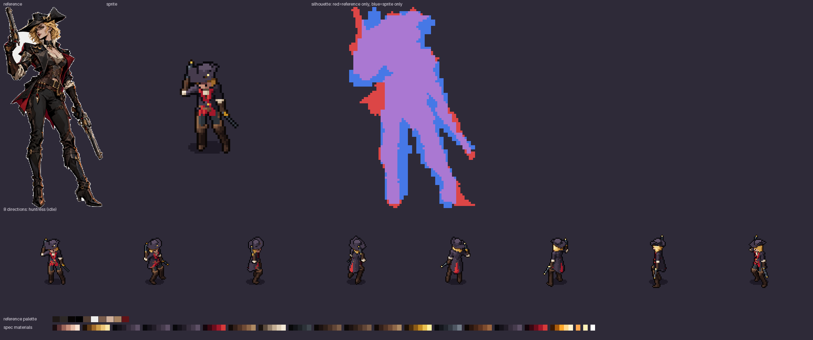

# From your splash art, with an AI

You have a character's splash art (concept art, an illustration) and want it as an animated sprite in 8
directions. This is how the Huntress of Hunt Tower was made: an AI assistant modeled her from the art,
compared the silhouette, took an art director's notes, then animated her.


Use an assistant that can **see images** (Claude Code, Codex, Gemini, Copilot or Cursor with a vision
model): judging the silhouette and the readability needs eyes. One that cannot see can still work from the
numbers of `ref compare` and `review`, but check its results yourself.

## 1. Set up

In your game folder, once:

```
pip install spritekiln
spritekiln init --engine godot --ai claude      # your engine and assistant
```

Your art must be **yours to use**. A PNG with transparency gives the best cutout; a flat, gradient or
vignetted background works too.

## 2. Ask

> Here is the splash art of our gunslinger, `art/huntress.png`. Make her a SpriteKiln character named
> `huntress`, following the recipe in `.spritekiln/agent/recipe.md`: model her from the art, compare the
> silhouette, review it as an art director, then animate idle, run and a pistol shot. Show me the pose
> sheet before you animate.

What the assistant does, and what you can check at each step:

1. **Prepare the reference:** `spritekiln new huntress --ref art/huntress.png` and
   `spritekiln ref prep .../splash.png`, which cuts the character out and extracts a palette with
   hue-shifted ramps. Check `splash_ref/cutout.png`: if the cut is wrong, everything after it is too.
2. **Write the brief** at the top of the spec: a one-line summary, the proportions, 3–6 traits that must
   survive at 64 px (the hat, two pistols, the red lining) and what will be simplified.
3. **Block out** the big masses from the template, then compare:
   `spritekiln ref compare huntress.yaml splash.png --dir s`. The silhouette score (IoU) is corrected for
   the game camera's tilt; 0.65 or more in the art's direction is the goal, 0.85 is plenty.
4. **Add the striking shapes** one at a time, checking all 8 directions: the back and the diagonals are
   invented from what the art suggests, and the decisions are written in the brief.
5. **Art direction pass:** a reviewer (another agent, or the same one wearing that hat) looks at the pose
   sheet, the comparison sheet and `spritekiln review` (value, contrast, pixels per material, legibility
   over your game's floor with `--bg`), and returns at most 8 concrete fixes.
6. **Animate**, with events where the game needs them (`hit`, `release`, `step_l`) and sockets where
   effects appear (the muzzle of each pistol).
7. **Render and export.**



## 3. Review it yourself

Before you accept the result:

- Open `out/pose_rest_0.png` (or the latest pose) and the comparison sheet. Is it recognizably the
  character from across the room? Squint: the silhouette and two or three colours are what survive.
- Open `out/<name>/preview/contact_<anim>.png` and the GIFs. Does the idle have the character's attitude
  (heavy, nimble, arrogant)? Does the attack read in `n`, where the body hides the arms?
- Run `spritekiln review <spec> --bg <a capture of your floor>` to see the sprite over your game.

Ask for changes in plain words ("the hat brim hides the face in `s`", "her coat should flare more when she
runs"); the assistant turns them into spec edits.

## What to expect

At 64 px the sprite keeps the identity, not the brush strokes: silhouette, proportions, the main colours,
one or two signature details. Exaggerate what is iconic: at this size, exaggeration is fidelity. Small
ornaments become a spot of colour or disappear.

For the Hunt Tower characters the art-direction round caught a sprite too dark for the game's floor, an
asymmetric hat, the face hidden under the brim, and weapons vanishing in direction `s`. Those are the
kinds of problems to look for.

The full method the assistant follows is in [splash-to-model.md](../agent/splash-to-model.md) and
[recipe.md](../agent/recipe.md).
