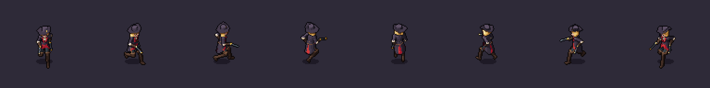
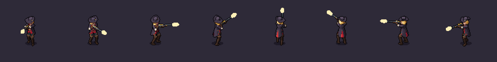
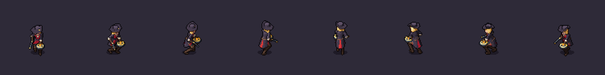
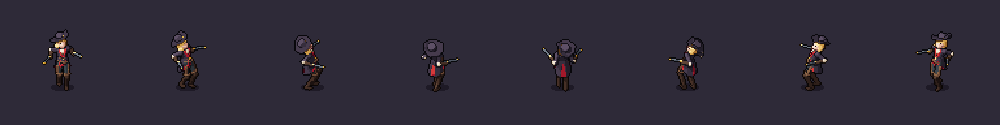
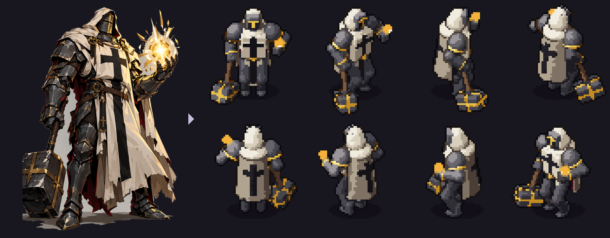
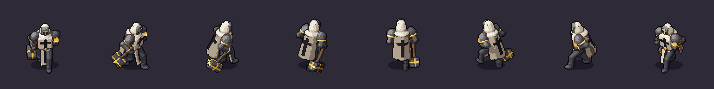
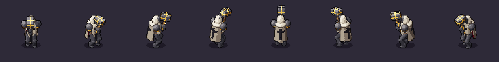
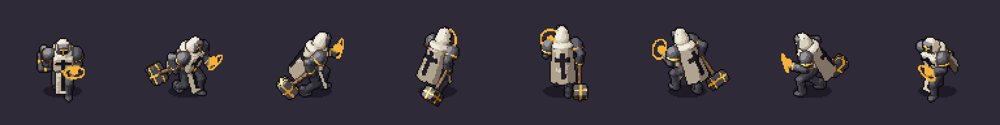
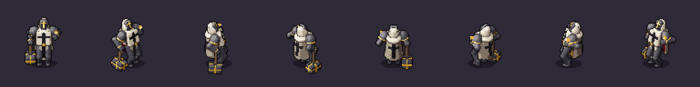
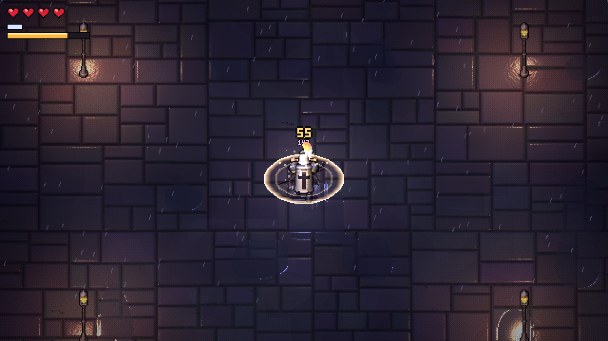

# Showcase

Two characters of the game **Hunt Tower**, made with SpriteKiln from their splash arts by Claude Code
following the [recipe](../docs/agent/recipe.md) (modeler → art director → modeler → animator → art director).
Their specs are in [`specs/characters/huntress`](../specs/characters/huntress) and
[`specs/characters/templar`](../specs/characters/templar), next to the splash arts.

## The Huntress
A gunslinger with two pistols, a rifle and mines: 13 animations in 8 directions, sockets for every muzzle
(within 0.3 px of the muzzle flash in all directions) and timing targets for the shots.

| Idle | Run | Rifle shot | Placing a mine | Death |
|---|---|---|---|---|
|  |  |  |  |  |

[Run, every frame and direction](huntress/contact_run.png)

## The Templar
A war-hammer knight with a holy light in his off hand: heavy and light attacks, a dash and a channelled
special, with the hammer's impact on the frame where the game deals damage.

| Idle | Run | Heavy attack | Special | Death |
|---|---|---|---|---|
|  |  |  |  |  |

[Heavy attack, every frame and direction](templar/contact_attack_heavy.png)

## In the game

[The Templar's frames under the game's lights](game/templar_lit_in_game.png) (normal map and emissive layer).

## Rebuild
`from_this_to_this.png` and `turnaround.gif` come from `python tools/make_showcase.py <spec> showcase/<name>`
after a render; the other GIFs and contact sheets are copied from the render's `preview/` folder.

## License
Everything in this folder, and the Templar and Huntress specs, splash arts and palettes: © 2026 Lucas Ramos /
PlayRPG, all rights reserved, included for demonstration only ([terms](../LICENSES/LicenseRef-Showcase.txt)).
