# Showcase

Characters made with SpriteKiln from their splash arts by Claude Code following the
[recipe](../docs/agent/recipe.md) (modeler → art director → modeler → animator → art director). RIN-7 and the
Ranger come from test projects of release 0.3, Thor from a test project of 0.1, the Templar and the Huntress
from the game **Hunt Tower**.

## RIN-7, a cyberpunk duelist (side view)
A side-scroller heroine with two blades: 48 px tall in a 64 px frame, toon shading, the e and w profiles drawn
separately because her suit is asymmetric. 7 clips (idle, run, jump, rise, fall, land, a double slash), 84
frames, with the `takeoff`, `hit` and `hit2` events and a socket on each blade that the game uses for its
hitboxes.

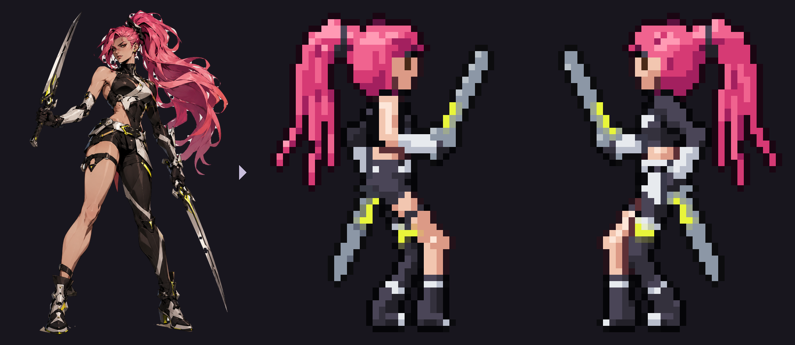

| Idle | Run | Double slash |
|---|---|---|
| 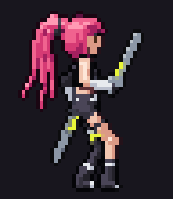 |  |  |

In a Godot test scene at 1920×1080: RIN-7 and the guard are SpriteKiln sprites lit by the neon through their
normal maps; the city, the rain and the slash glow are the scene's.

## The Ranger, a dark-fantasy hunter (top-down)
Mechanical arms and a war crossbow as tall as she is: 64 px tall in a 144 px frame (room for the crossbow
aimed sideways), 8 directions. 4 clips (idle, run, dash, attack), 288 frames; the crossbow is its own bone
chain with channels for the aim, the draw and the bolt.

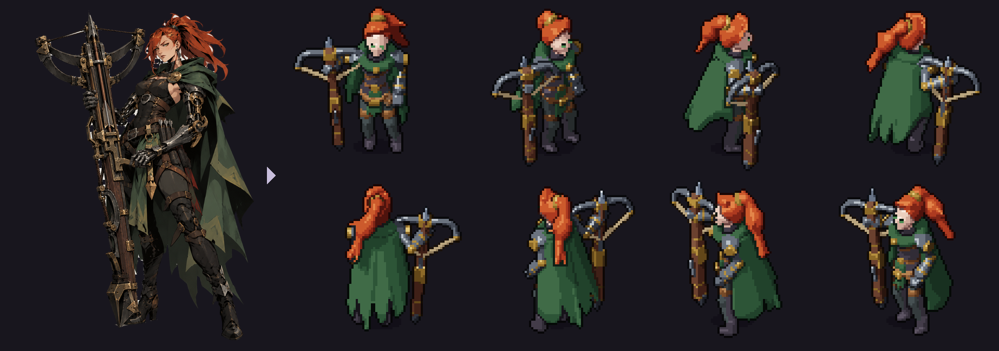

| Idle | Run | Dash | Shot and reload |
|---|---|---|---|
|  | 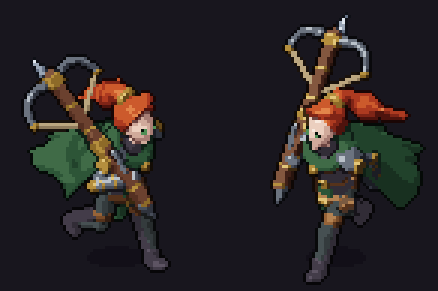 | 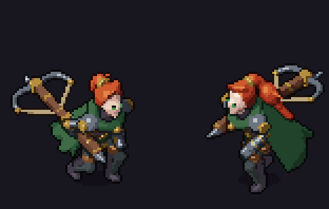 |  |

## Thor, a storm god (top-down, high detail)
About 100 px tall in a 128 px frame, twice SpriteKiln's default density: 13 clips in 8 directions (idle and
run, with and without the hammer, two attacks, a hammer throw and catch, a charge, a dash and a three-part
ultimate), 696 frames, with an emissive layer for the lightning.

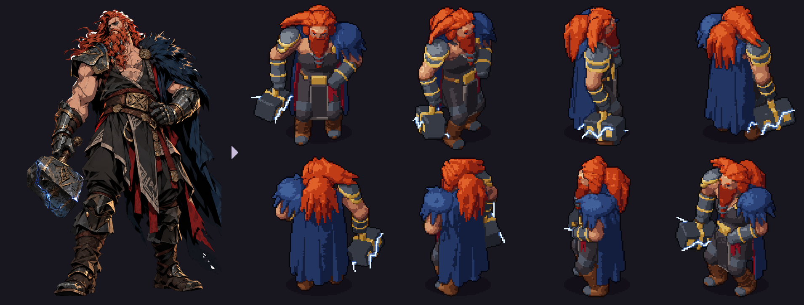

| Idle | Attack | Charge | Ultimate slam |
|---|---|---|---|
|  | 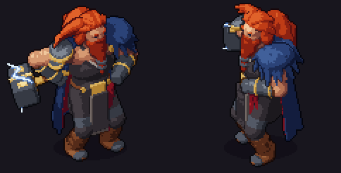 | 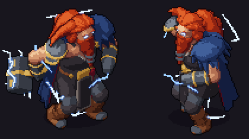 |  |

## The Huntress (Hunt Tower)
A gunslinger with two pistols, a rifle and mines: 13 animations in 8 directions, sockets for every muzzle
(within 0.3 px of the muzzle flash in all directions) and timing targets for the shots. Her spec is in
[`specs/characters/huntress`](../specs/characters/huntress), next to the splash art.

| Idle | Run | Rifle shot | Placing a mine | Death |
|---|---|---|---|---|
| 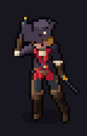 | 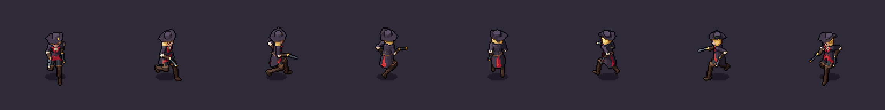 | 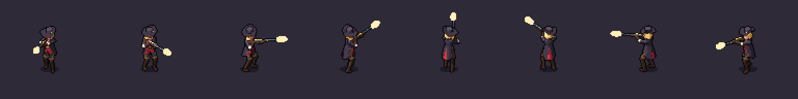 | 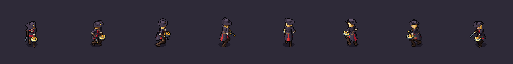 | 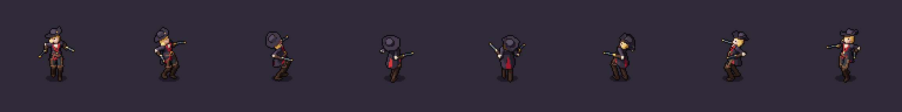 |

[Run, every frame and direction](huntress/contact_run.png)

## The Templar (Hunt Tower)
A war-hammer knight with a holy light in his off hand: heavy and light attacks, a dash and a channelled
special, with the hammer's impact on the frame where the game deals damage. His spec is in
[`specs/characters/templar`](../specs/characters/templar).

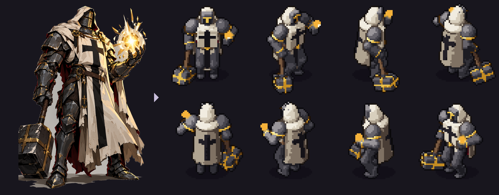

| Idle | Run | Heavy attack | Special | Death |
|---|---|---|---|---|
| 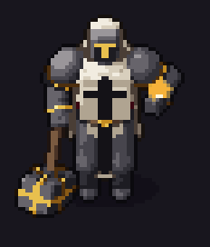 | 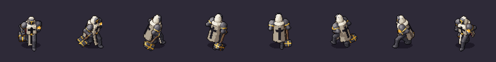 | 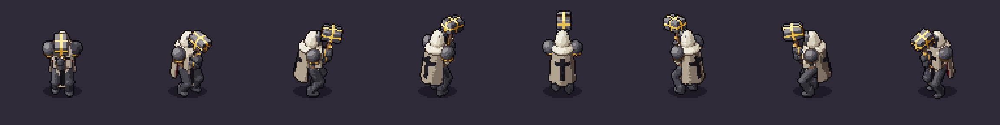 | 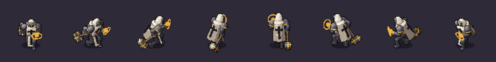 | 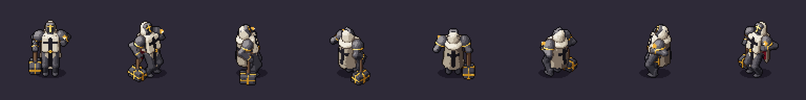 |

[Heavy attack, every frame and direction](templar/contact_attack_heavy.png)

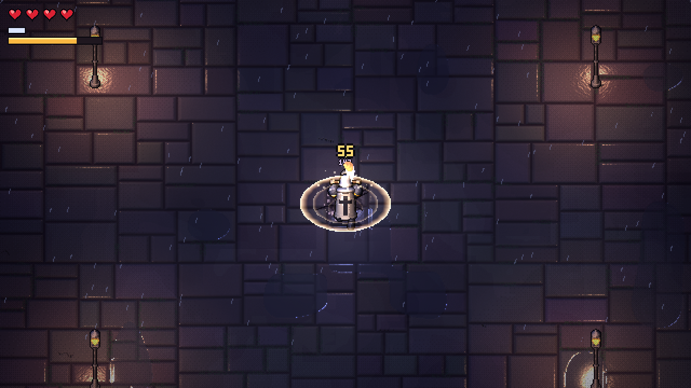

[The Templar's frames under the game's lights](game/templar_lit_in_game.png) (normal map and emissive layer).

## Rebuild
`python tools/make_showcase.py <spec> showcase/<name> [--scale 4] [--clip attack:se,sw] [--splash <art>]` after a
render writes `from_this_to_this.png`, `turnaround.gif` and one GIF per `--clip`. The Hunt Tower GIFs and
contact sheets are copied from the render's `preview/` folder.

## License
Everything in this folder, and the Templar and Huntress specs, splash arts and palettes: © 2026 Lucas Ramos
(Hunt Tower: Lucas Ramos / PlayRPG), all rights reserved, included for demonstration only
([terms](../LICENSES/LicenseRef-Showcase.txt)).
